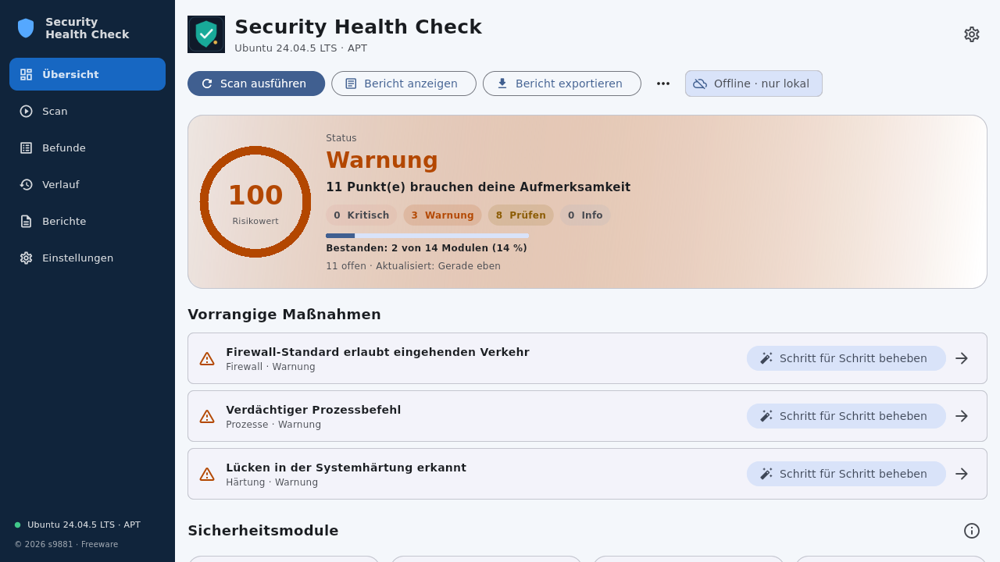

  

<h1 align="center">Security Health Check</h1>

  <b>Offline-Sicherheitsprüfung für Linux, macOS und Windows.</b> 
  Den Sicherheitszustand deines Computers auf einen Blick sehen, jeden Befund verstehen und Probleme Schritt für Schritt beheben – ohne Cloud, Konto oder Telemetrie.

  
  
  

<a href="README.md">🇬🇧 English version</a>

> **Nutzung auf eigenes Risiko.** Security Health Check ist kostenlose Software und wird „wie besehen“ bereitgestellt. Ergebnisse sind Hinweise, keine Garantien, und vorgeschlagene Befehle können dein System verändern. Du bestätigst das bei jedem Start. Siehe [LICENSE](LICENSE).

## Download

Die aktuelle Version gibt es unter **[Releases](../../releases/latest)** – Entwicklerwerkzeuge werden nicht benötigt.

| System | Datei | Installation |
| --- | --- | --- |
| Debian, Ubuntu, Linux Mint | `security-health-check_<version>_amd64.deb` | `sudo apt install ./security-health-check_<version>_amd64.deb` – App im Startmenü und Befehl `security-health-check` |
| Andere Linux-Systeme (x64) | `security-health-check-<version>-linux-x64.tar.gz` | entpacken und `./linux_security_health_check` starten (benötigt GTK 3) |
| macOS 12 oder neuer | `Security-Health-Check-<version>.dmg` | öffnen, in *Programme* ziehen; erster Start: Rechtsklick › *Öffnen* |
| Windows 10/11 | `Security-Health-Check-<version>-Setup.exe` | Installationsprogramm starten (oder die portable `.zip` nutzen) |

Prüfe den Download mit der Datei `SHA256SUMS`. Manche Prüfungen brauchen Administratorrechte; ohne sie bleibt das Ergebnis auf „Prüfen“.

## Funktionen

- 🔒 **Offline und privat** – kein Server, kein Konto, keine Telemetrie. Ergebnisse bleiben auf deinem Computer.
- 🧭 **Verständliche Ergebnisse** – Risikowert, Erklärungen in Klartext und vorrangige Maßnahmen.
- 🛠️ **Schritt für Schritt beheben** – Risiko verstehen, vorgeschlagenen Befehl erst nach zwei Bestätigungen ausführen, mit neuem Scan prüfen.
- 🖥️ **Linux, macOS, Windows** – Debian/Ubuntu/Mint, Fedora/RHEL, openSUSE, Arch, Alpine, macOS 12+, Windows 10/11.
- 🩹 **Sicherheitsupdates** – zeigt ausstehende Sicherheitskorrekturen aus den Update-Daten deines Systems.
- 🔍 **Viele Prüfungen** – Firewall, offene Ports, Dienste, Autostart, Konten, SSH-Schlüssel, Prozesse, Updates, Verschlüsselung, Secure Boot, SIP/Gatekeeper/FileVault, Defender/BitLocker/UAC, Docker, Passwortrichtlinie, Backups.
- ✅ **Akzeptierte Risiken** – Entscheidung mit Begründung und Ablaufdatum dokumentieren.
- 📄 **Berichte** – PDF, Text, JSON, Markdown, CSV und SARIF.
- ⌨️ **Kommandozeile** – `security-health-check scan` für Server, Überwachung und geplante Scans.
- 🌍 **Deutsch und Englisch** – umschaltbar in den *Einstellungen*.

## Datenschutz

Die App arbeitet vollständig offline: Sie prüft nur den Computer, auf dem sie läuft, scannt keine anderen Geräte oder Netzwerke und sendet keine Daten. Nur Aktionen, die du selbst startest (z. B. „Paketlisten aktualisieren“), kontaktieren die Update-Server deines Systems – nach Anzeige des genauen Befehls und zweifacher Bestätigung.

## Lizenz

**Freeware** – © 2026 s9881. Alle Rechte vorbehalten. Kostenlos nutzbar, privat und gewerblich, gemäß [Lizenzvertrag](LICENSE). Veränderung, Dekompilierung, Weiterverkauf und Weitergabe unter anderem Namen sind nicht gestattet. Der Quellcode wird nicht veröffentlicht.

Das Programm enthält Open-Source-Komponenten (Flutter, Dart u. a.). Ihre Lizenzen stehen in der App unter *Weitere Aktionen › Open-Source-Lizenzen*, werden mit `security-health-check licenses --full` ausgegeben und sind in [THIRD_PARTY_NOTICES.md](THIRD_PARTY_NOTICES.md) aufgeführt.

## Hilfe

Problem gefunden? Eröffne ein [Issue](../../issues). Bitte keine persönlichen Daten oder vollständigen Scan-Berichte öffentlich posten.
