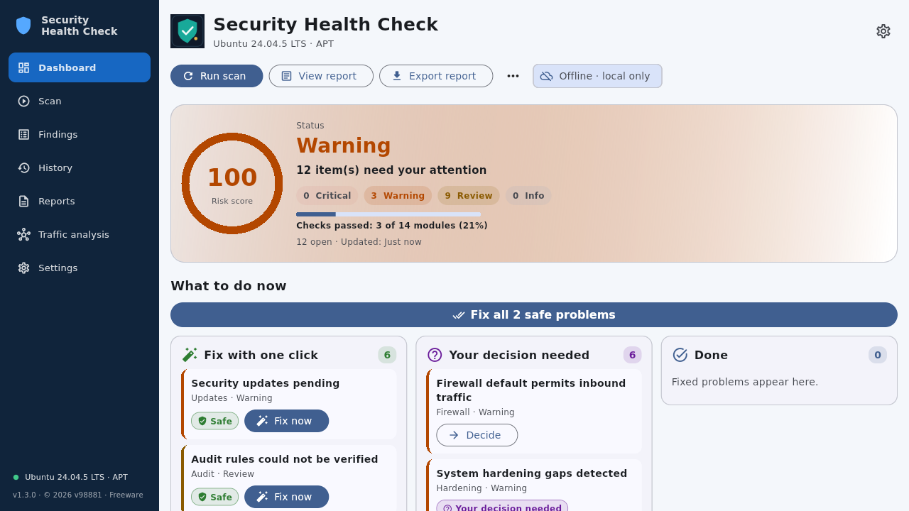
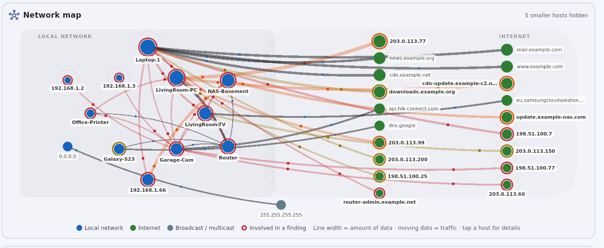
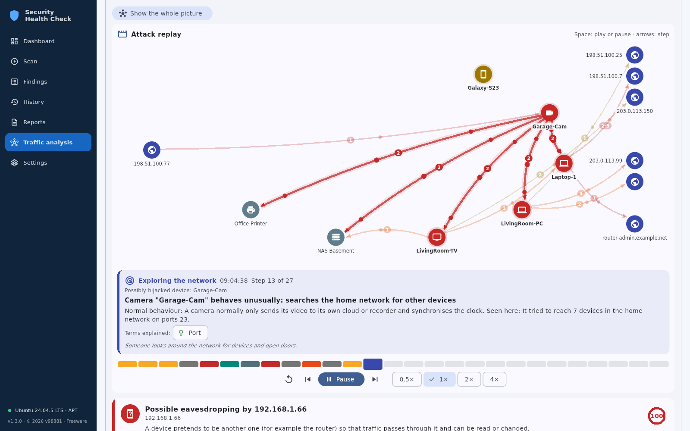
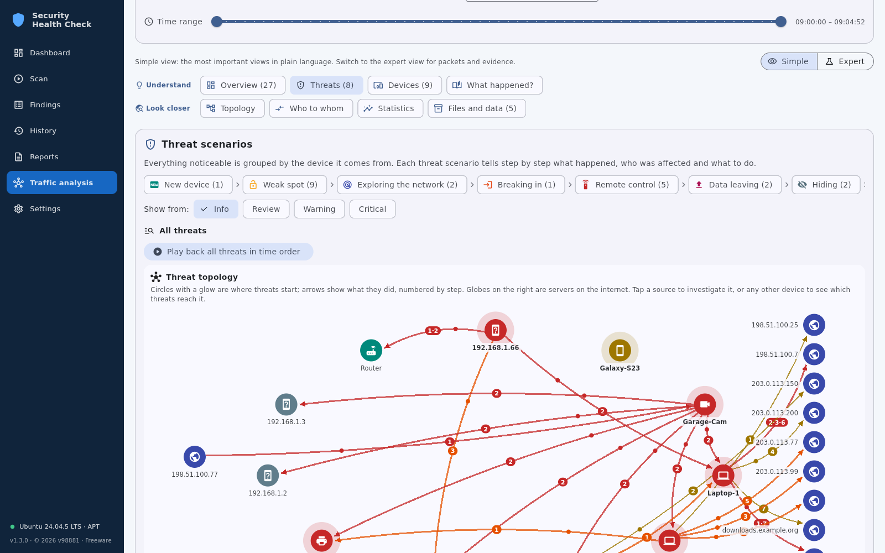
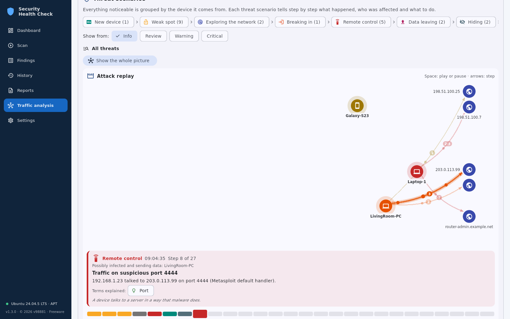
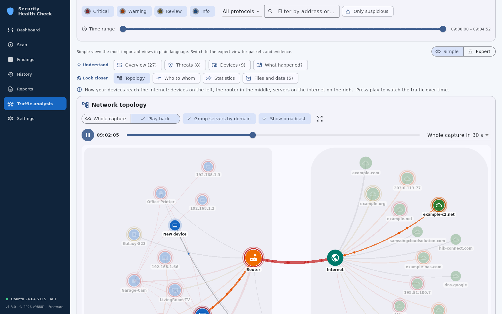
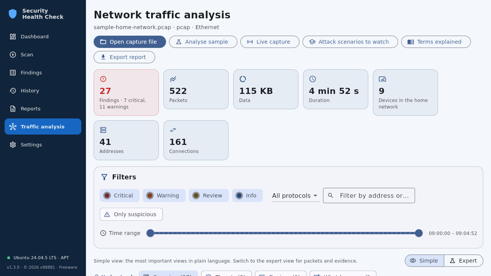

  

<h1 align="center">Security Health Check</h1>

  <b>Your home security check – offline, free, in plain words.</b> 
  Scan your own computer and home network, understand every finding, fix it with one click.

  
  
  
  

## ⚡ What it does

- 🛡️ **One score, one look** – firewall, updates, SSH, accounts, open ports and more in a single dashboard.
- 🪄 **Fix with one click** – safe fixes run right away; risky ones wait for your decision.
- 🗣️ **Plain words** – every finding says what it means, why it matters and what to do.
- 🔒 **Nothing leaves your computer** – no cloud, no account, no telemetry.
<!--- - 🌐 **See your network** – open a Wireshark capture and spot port scans, clear-text passwords, ARP spoofing and suspicious check-ins.-->

<!--## 🌐 See your whole network

Every device, every server, every connection – findings glow red.

## ▶️ Press play – watch the attack unfold

Replay all threats step by step in time order, with pause, step and speed control.

| Threat topology | One step explained |
| --- | --- |
|  |  |

Or play back the whole capture on the network topology and see who talked to whom, and when.

-->

## 📦 Download

Grab the file for your system from the **[latest release](../../releases/latest)**:

| System | File |
| --- | --- |
| Debian, Ubuntu, Mint | `.deb` |
| Other Linux (x64) | `.tar.gz` |
| macOS 12+ | `.dmg` |
| Windows 10/11 | `Setup.exe` or portable `.zip` |

Every version is published as a release tag (`v1.x.x`).

## 🏠 Made for home

For private people, their own computers and their own home network – not for companies or organisations. Results are indicators, not guarantees; suggested commands change your system, so review them first.

Freeware, use at your own risk: [LICENSE](LICENSE) · [DISCLAIMER](DISCLAIMER.md) · [SECURITY](SECURITY.md) · [Third-party notices](THIRD_PARTY_NOTICES.md)

© 2026 v98881
