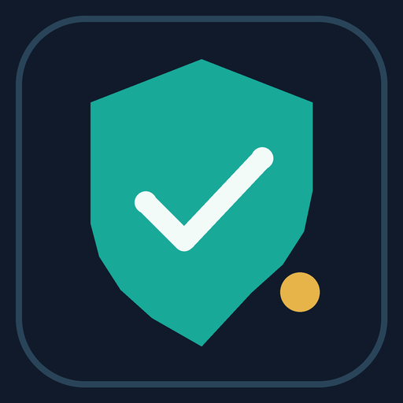
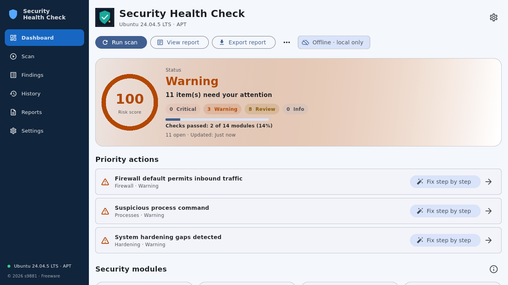
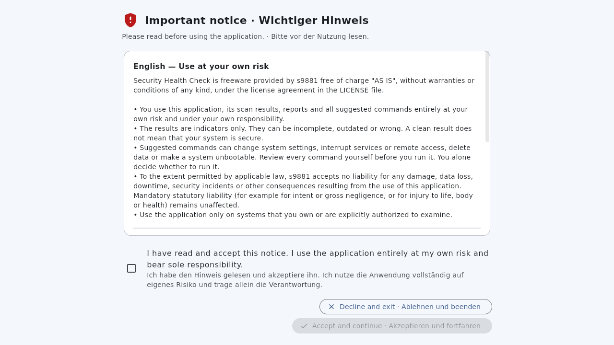
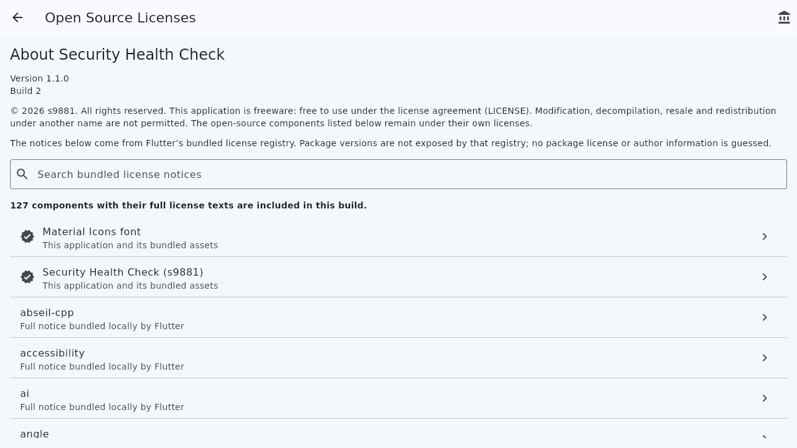

  

<h1 align="center">Security Health Check</h1>

  <b>Offline home security check for your own Linux, macOS and Windows computers and your home network.</b> 
  <b>For private home use only – not for companies or other organisations.</b> 
  See your computer's security state at a glance, understand every finding and fix issues step by step — no cloud, no account, no telemetry.

  
  
  
  

> **Made for home use only.** Security Health Check is a home security tool for private people who want to check their own computers and their own home network. It is **not** made, tested or intended for companies, public authorities, schools, associations or other organisations, nor for professional, commercial or critical use (for example audits, penetration tests, forensics, compliance, monitoring of employees or customers, or industrial and medical systems). It does not replace professional security products or advice.
>
> **Use at your own risk.** Security Health Check is free software provided "AS IS". Results are indicators, not guarantees, and suggested commands can change your system. You accept this on every start. See [LICENSE](LICENSE).

## Why this app?

**Cyber attacks are increasing all over the world, and they no longer stop at the front door.** That is why it matters more than ever to protect the network in every single home. Security grows from the bottom up: every home that is a little safer makes the whole internet a little safer.

- **Your home is part of the internet.** Banking, work from home, health data, family photos, the children's tablets, the camera at the door and the TV all share one network. What happens there is worth protecting.
- **Nobody checks it for you.** A company has an IT department. At home there is only you. This app is the second pair of eyes that looks at your computers and your home network and tells you what it sees.
- **Understanding is the best protection.** Every finding is explained in plain words: what it means, why it matters and what you can do. You do not have to be an expert, and you learn something with every check.
- **Protecting yourself protects others.** Unprotected home devices are taken over and used to attack other people. Every router, camera and computer that is looked after is one device less in the hands of attackers.
- **Your data stays with you.** Everything runs offline on your own computer. No account, no cloud, no telemetry, no upload. A security tool should not be one more thing that watches you.
- **Security should not depend on money.** The app is freeware: free of charge for everyone at home, under the license agreement in [LICENSE](LICENSE). It stands on open-source work and says thank you for it inside the app.
- **Small steps count.** One closed port, one update, one changed password: every fix makes an attack a little harder. You do not have to do everything today – you only have to start.

**Made for homes, and only for homes.** Security Health Check is built for private people, their own computers and their own home network. It is not suited for companies, public authorities or other organisations, and it does not replace professional security products or advice. It is an honest helper for the place where most of us are on our own: at home.

## Who is it for?

| ✅ Made for | ❌ Not made for |
| --- | --- |
| Private people at home | Companies, self-employed work and offices |
| Your own PC, laptop, home server or NAS | Public authorities, schools, hospitals, associations |
| Your own home network and Wi-Fi | Networks or devices of employers, customers or other people |
| Learning what happens in your home network | Audits, penetration tests, forensics, compliance or legal evidence |
| | Industrial, medical or other critical systems |

## Download

Get the latest version from **[Releases](../../releases/latest)** — no installation of developer tools needed.

| System | File | How to install |
| --- | --- | --- |
| Debian, Ubuntu, Linux Mint | `security-health-check_<version>_amd64.deb` | `sudo apt install ./security-health-check_<version>_amd64.deb` — adds the app to the menu and the `security-health-check` command |
| Other Linux (x64) | `security-health-check-<version>-linux-x64.tar.gz` | extract and run `./linux_security_health_check` (needs GTK 3) |
| macOS 12 or later | `Security-Health-Check-<version>.dmg` | open, drag to *Applications*; first start: right-click › *Open* |
| Windows 10/11 | `Security-Health-Check-<version>-Setup.exe` | run the installer (or use the portable `.zip`) |

Check your download with the `SHA256SUMS` file. Some checks need administrator rights; without them the result stays marked as *Review*.

## Features

- 🔒 **Offline & private** — no server, no account, no telemetry. Scan results stay on your computer.
- 🧭 **Clear results** — risk score, plain-language explanations and priority actions. Unknown is never shown as "secure".
- 🛠️ **Fix step by step** — understand the risk, run a suggested command only after two confirmations, verify with a new scan.
- 🖥️ **Linux, macOS, Windows** — Debian/Ubuntu/Mint, Fedora/RHEL, openSUSE, Arch, Alpine, macOS 12+, Windows 10/11.
- 🩹 **Security updates** — shows pending security fixes from your system's update data.
- 🔍 **Many checks** — firewall, open ports, services, startup items, accounts, SSH keys, processes, updates, disk encryption, Secure Boot, SIP/Gatekeeper/FileVault, Defender/BitLocker/UAC, Docker, password policy, backups.
- ✅ **Accepted risks** — document a decision with reason and expiry date.
- 📄 **Reports** — PDF, text, JSON, Markdown, CSV and SARIF.
- ⌨️ **Command-line tool** — `security-health-check scan` for a home server or NAS and for scheduled scans.
- 🌍 **English & Deutsch** — switch in *Settings*.

| Startup notice | Open-source licenses |
| --- | --- |
|  |  |

## Privacy

The app works completely offline: it only examines the computer it runs on, never scans other devices or networks, and sends no data anywhere. Only actions you start yourself (for example "Refresh package lists") contact your system's update servers, after showing the exact command and asking twice.

## License

**Freeware** — © 2026 v98881. All rights reserved.

Free to use under the [Freeware License Agreement](LICENSE). The software is made and intended only for private home use (see [Who is it for?](#who-is-it-for)); it is not offered for companies or other organisations. Selling, redistributing, modifying or decompiling the software is not permitted without written permission. The source code is not published.

The software is provided **"AS IS", without warranty of any kind**. To the maximum extent permitted by applicable law, the author accepts **no liability** for any damage or loss arising from its use. You use it entirely at your own risk.

The program contains open-source components (Flutter, Dart and others). Their licenses are shown in the app under *More actions › Open Source Licenses*, printed by `security-health-check licenses --full`, and listed in [THIRD_PARTY_NOTICES.md](THIRD_PARTY_NOTICES.md).

## Support

Found a problem? Open an [issue](../../issues). Please do not post personal data or full scan reports publicly.
